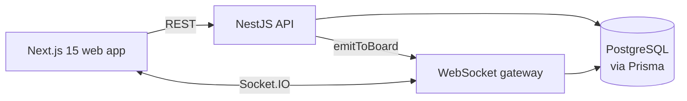

# Saas-Multitenant

A real-time task management platform (boards, kanban and calendar), built as the foundation for a multi-tenant B2B SaaS. I'm using it to learn backend architecture in depth: authorization, real-time sync, and how a single-tenant app grows into a multi-tenant one.

## Status

**Working today**: auth, boards, lists and tasks, drag-and-drop kanban, calendar scheduling, and live updates across every tab and device where the board is open.

**Next milestone, multi-tenancy**: the data model is still user-owned (each board has one owner). The next step is introducing organizations as the tenant boundary, with members and roles, and moving every access check from "is this your board" to "is this your organization's board".

## Features

- **Auth**: register and login with JWT (Passport local + JWT strategies), passwords hashed with bcrypt, and rate limiting on auth endpoints (3 registrations and 5 logins per minute per client).
- **Boards, lists and tasks**: tasks have priority (low → urgent), status (todo / in progress / done), an assignee, an optional due date and a manual order.
- **Kanban**: drag-and-drop between lists with dnd-kit.
- **Calendar**: schedule tasks by due date with FullCalendar, including a view of unscheduled tasks.
- **Real-time**: changes are pushed over Socket.IO to every open session on the same board. Once boards are shared within an organization, the same rooms carry collaboration between users.

## Architecture



A pnpm + Turborepo monorepo:

```
apps/
  api/        # NestJS: auth, boards, lists, tasks, websocket gateway, Prisma
  web/        # Next.js 15 + React 19, organized by feature modules
packages/
  types/      # types shared by API and web
  ui/         # component library (shadcn-style, Radix primitives)
  config/     # shared TypeScript/ESLint config
docs/
  plans/      # implementation plans, written before coding
  solutions/  # problems I hit and how they were solved
```

## Design decisions

- **One place for authorization.** `BoardAccessService` resolves a list or task back to its board and checks ownership before any write. When multi-tenancy arrives, this is the single function that changes, instead of checks scattered across controllers.
- **WebSockets are authorized twice.** The JWT is verified on connection, and joining a board's room re-checks that the user owns that board. A valid token alone isn't enough to listen to someone else's board.
- **The API emits, clients don't broadcast.** After a write succeeds, the API calls `emitToBoard`, so only persisted changes reach other clients and the database stays the source of truth.
- **Shared types package.** API and web import the same types from `packages/types`, so a change in a payload shape breaks the build on both sides instead of at runtime.
- **Write the plan first, write down the fix after.** Each feature starts as a plan in `docs/plans/`, and every non-obvious problem gets a write-up in `docs/solutions/`: rate limiting auth endpoints, a hydration mismatch caused by an auth guard, FullCalendar quirks in Next.js 15, a module resolution failure, and the design system and kanban redesign.

## Tech stack

- **API**: NestJS, Prisma, PostgreSQL, Passport (local + JWT), @nestjs/throttler, Socket.IO, class-validator.
- **Web**: Next.js 15, React 19, TanStack Query, Zustand, dnd-kit, FullCalendar, Radix UI, Tailwind, Sonner.
- **Tooling**: pnpm workspaces, Turborepo, TypeScript, Jest.

## Getting started

Prerequisites: Node.js 20+, pnpm 10, and a PostgreSQL database.

```bash
cp .env.example .env       # set DATABASE_URL and JWT_SECRET
cp .env apps/api/.env      # the Prisma CLI reads its own .env
pnpm install
pnpm --filter @task-manager/api db:migrate
pnpm dev                   # API on :3001, web on :3000
```

## License

MIT
